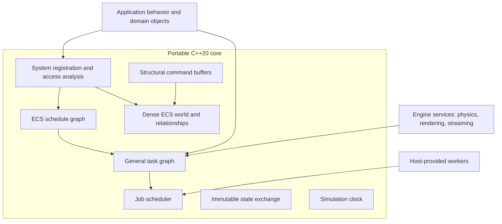
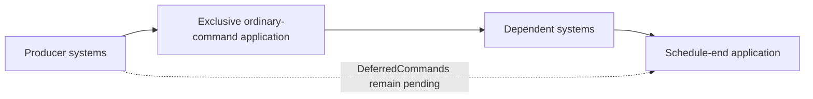

# Riviera Engine Core — High-Level Design

## Architectural direction

The core separates data storage from execution. ECS is the model for entity
composition and efficient processing of game-world data. A general-purpose task
scheduler is the execution foundation for ECS systems and for work that has no
world at all. Physics libraries, complex C++ objects, and device services retain
their own appropriate representations.

The target ECS follows Bevy's model: dense component storage, ordinary component
fields, access declarations derived from system parameters, and structural
changes applied at scheduled boundaries. An additional command category,
`DeferredCommands`, delays its structural changes until the end of its schedule.
This replaces the previous concurrently mutable, reference-counted ECS design.

This document defines the target architecture and its reasons. API details and
implementation constraints belong in the [boundary reference](CORE_BOUNDARY.md).
The [engine HLD](../../riviera-engine/docs/ENGINE_DESIGN.md) describes platforms,
rendering, physics integration, and device services.

## System context

Core owns no platform event loop, operating-system worker pool, graphics device,
physics engine, or audio device. Consumers link it as an ordinary C++ library.
The same data and execution model can run natively or under WebAssembly; platform
adapters do not enter the world or system scheduler.

The dependency direction is one-way: the ECS scheduler uses the task scheduler,
while the task scheduler knows nothing about ECS. It remains usable for loading,
physics, audio preparation, or standalone tools.

## World and dense storage

A world owns entity identities, component storage, and locations within that
storage. An identity contains an index and a generation. Reusing an entity slot
does not make an old reference point to its replacement. Identities belong to a
world, rather than representing globally owned C++ objects.

Entities with the same component composition occupy an archetype. Components are
stored in dense typed columns, with corresponding rows representing the same
entities. Queries traverse matching tables and process contiguous data. Adding
or removing a component moves the entity to another composition; removing a row
compacts storage and updates the moved entity's location.

Components are not allocated individually or protected by lifetime reference
counts. Their addresses may change during structural operations. A component
reference is a borrow for the current execution interval and must not be retained
across a command-application boundary. Long-lived relationships use entity IDs
or subsystem handles, not component addresses.

Ordinary fields need no atomics because the scheduler prevents incompatible
accesses from overlapping. The world does not promise safety for arbitrary
external concurrent calls. Direct structural operations are reserved for
quiescent initialization, teardown, and command application; they cannot run
while scheduled systems traverse storage.

The initial implementation preserves a compile-time component universe for
existing consumers. Runtime component registration is an independent extension,
not a requirement of dense storage or signature-based access analysis.

## Automatic system scheduling

A system is an ordinary C++ function whose parameter types describe its access.
Read access borrows immutable component data; write access borrows mutable data.
Command parameters provide recording buffers instead of direct structural access.
The consumer does not separately maintain a handwritten READ/WRITE manifest.

During schedule preparation, the scheduler derives access sets, incorporates
explicit logical ordering, diagnoses ambiguous conflicting systems, and rejects
cycles. Read/read access is compatible. Read/write and write/write access to the
same component type must not overlap. Compatibility determines where parallelism
is safe; it does not determine the intended logical order of conflicting behavior.
That order is expressed through before/after relationships.

The prepared dependency graph is cached between runs. System registration or
ordering changes invalidate it; ordinary component value changes do not. Running
a schedule initializes execution state for the cached graph and submits work to
the existing job scheduler. There is no second ECS executor or worker pool.

Access safety applies only to declared data. A system that captures a physics
world or another mutable external object must obey that object's ownership and
ordering contract. The scheduler cannot infer an external conflict from a C++
closure. Such work may use explicit dependencies or run as ordinary task-graph
work without being forced into components.

## Structural commands and visibility

Each system records into its own command buffers, avoiding contention on a shared
world-wide producer queue. Buffers retain and reuse their recording memory.
Application happens when active borrows have ended, allowing tables to migrate
and compact safely. Operations can be applied in batches where their semantics
permit it.

| Category | Visibility boundary |
| --- | --- |
| Commands | Applied before explicitly dependent systems need the producer's structural changes, and at schedule completion. |
| DeferredCommands | Applied only at the end of the schedule, without generating intermediate application points. |

The ordinary command rule follows
[Bevy's automatic deferred application](https://docs.rs/bevy_ecs/latest/bevy_ecs/schedule/struct.ApplyDeferred.html).
An explicit dependent system observes its producer's ordinary commands even when
the dependency is transitive. Unrelated systems are not entitled to observe those
changes at an arbitrary point during the schedule.

A command-application node is exclusive with respect to every system accessing
that world, including otherwise independent readers. The graph creates this
quiescence through dependencies rather than acquiring a world mutex. Returning
from a producer alone is insufficient if another system still holds a borrow.

Intermediate application never drains `DeferredCommands`, including when the
same producer also records ordinary commands. End-of-schedule application gives
both categories a defined completion boundary. Entity references in recorded
operations must be resolved and generation-checked at application; stale IDs
cannot alias a reused entity.

## General execution and two levels of parallelism

The task graph describes dependencies between units of work. The job scheduler
executes ready units using host-provided workers or cooperative execution on the
calling thread. ECS is one producer of such graphs; a standalone task needs no
world, component types, or system registration.

There are two distinct sources of parallelism. Independent systems can run at
the same time, and one large system can divide its data into disjoint ranges.
A large particle update must not depend on having many unrelated systems to use
available workers. Range work uses the same execution mechanism and worker budget.

The completion boundary of a subdivided system must include all its range tasks.
Its access reservation, borrowed data, and dependent systems remain valid until
those tasks finish. Starting asynchronous children and returning early would
violate the access contract. Synchronously waiting inside a worker for the same
pool is also unsuitable; execution needs a dependency-based fork/join boundary.
A subdivided system becomes a preparation task, disjoint range tasks, and a
completion node in the cached graph. Preparation measures its current iteration
domain after preceding structural commands have been applied. Dependent systems
wait for the completion node, including every range. Changes to entity counts do
not require rebuilding graph topology.

Partitioning is an explicit system contract. A range identifies rows of one
component domain; other components are joined by entity identity, since ordinal
positions in different component views need not match. Each partition writes
only its assigned rows. Command recording within partition callbacks requires
separate producer buffers and is outside the initial range-system interface.

No authored core algorithm uses mutexes, condition variables, semaphores, or
blocking atomic waits. Atomic readiness counters and publication are permitted.
The ECS world itself uses scheduling and quiescent phases, not lock-free hash
storage or atomic component fields. These are separate strategies for separate
responsibilities; allocators and external libraries retain their own guarantees.

## Schedules and composition

Startup, FixedUpdate, Update, and RenderExtract are distinct schedules with their
own system graphs. Startup initializes application state. FixedUpdate advances
simulation at the selected logical cadence. Update handles per-frame behavior.
RenderExtract derives presentation data after the required simulation work.
A schedule's identity does not require a dedicated thread.

Modules register their systems and standard dependencies during composition.
A consumer selects modules and application-specific ordering; it does not have
to reconstruct every built-in dependency. Core supplies this registration model
without depending on physics, rendering, or game-specific module implementations.

Schedules sharing a world cannot overlap unless a higher-level plan also proves
their access compatibility. Initially their execution is ordered at the host
boundary. Concurrent rendering is enabled through snapshots, rather than by
allowing the render device to traverse a world being mutated by simulation.

## Time, hierarchy, and immutable publication

The fixed-step clock separates simulation time from host frame pacing and bounds
catch-up work. Applications select step rate and overload behavior. Fixed steps
are useful for repeatable simulation but do not establish cross-platform
determinism, rollback, or replay on their own.

Local transforms, global transforms, and parent relationships are ordinary ECS
components. Transform propagation is a system: it reads local transforms and
relationships and writes global transforms. Its position in the graph follows
those access declarations and the module's logical dependencies. Individual
matrix elements do not need atomic access.

Extraction is independent of structural command application. The new
`RequestedExchange<T>` lets a consumer request an extraction while the producer
continues on its own cadence. The producer fills reusable presentation payload
storage only at a safe boundary when a request is pending. It never waits for the
consumer and never builds extraction payloads without a request.

`SnapshotExchange<T>` remains available to consumers that need retained previous
and current publications, interpolation history, or its bounded Xenium-backed
lifetime model. The requested exchange is a separate policy for on-demand
extraction. Neither payload form may contain borrowed mutable component pointers.

## Decisions and consequences

| Decision | Consequence |
| --- | --- |
| Dense archetype tables | Efficient sequential traversal; structural changes can move component addresses. |
| Scheduler-owned access safety | Ordinary component fields; external unscheduled access remains a caller responsibility. |
| Commands at graph-defined boundaries | Safe storage mutation and explicit visibility instead of concurrent structural edits. |
| Additional end-only DeferredCommands | Background structural effects need not create intermediate application boundaries. |
| General job scheduler beneath ECS | Complex objects and third-party services retain their natural representations. |
| Independent immutable snapshots | Presentation never borrows a live mutable world across simulation updates. |

ECS is a useful world representation, not a mandatory representation of every
subsystem. A physics-body component can contain a Jolt handle; a vehicle can retain
an ordinary C++ engine and gearbox model. Only data that benefits from entity
composition or bulk processing needs to live in component tables.
